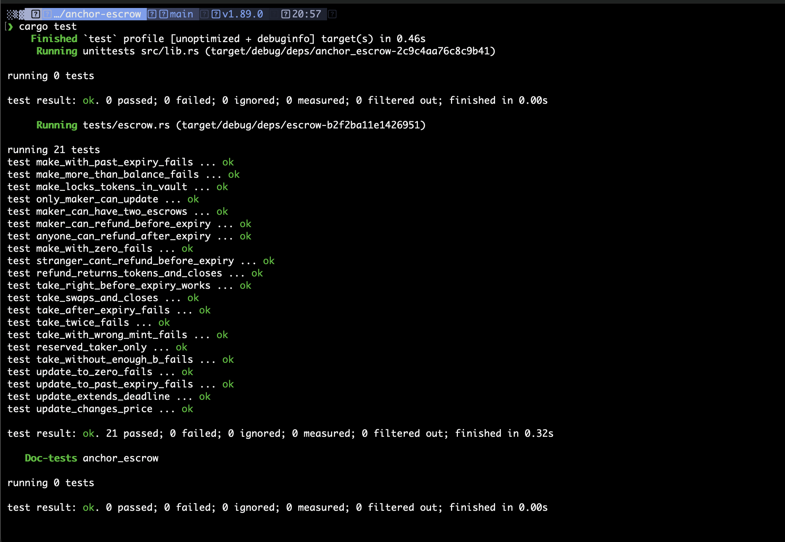

# anchor escrow (timed)

Turbin3 Q4 builders assignment. A token escrow where a maker locks token A and asks for some amount of token B. A taker sends the B and gets the A in one transaction, so neither side has to trust the other.

On top of the basic make / take / refund / update I added a time limit (task 4). Each escrow has a deadline checked against the `Clock` sysvar, plus an optional reserved taker.

Built with Anchor 1.1.2 + anchor-spl (token interface, so token-2022 mints work too). Tests use LiteSVM in Rust.

## accounts

- `escrow` PDA, seeds `["escrow", maker, seed]`. Stores maker, both mints, the receive amount, the deadline, the optional taker and the bump. The `seed` is a u64 the maker picks, so one maker can have several escrows open at the same time.
- `vault` is the associated token account for `mint_a` owned by the `escrow` PDA. It holds the maker's tokens until someone takes them or they get refunded.

## instructions

**make(seed, deposit, receive, expires_at, taker)**
Creates the escrow and the vault and moves `deposit` of token A from the maker into the vault. `expires_at` is a unix timestamp and has to be in the future. `taker` is an `Option<Pubkey>`: `None` means anyone can take it, `Some(wallet)` reserves it for that wallet.

**take**
The taker sends `receive` of token B to the maker and gets the whole vault of token A. Then the vault and the escrow get closed and the rent goes back to the maker, since the maker paid for them. Before any tokens move it checks:
- `now < expires_at`
- if a taker was set, the signer has to be that wallet (so the condition is "the right person signs before the deadline")

The taker's A account and the maker's B account are `init_if_needed`, so neither side needs them set up beforehand.

**refund**
Sends the token A back to the maker and closes both accounts. The maker can do it any time. After the deadline **anyone** can call it. The tokens and rent still only go to the maker, the caller just pays the tx fee. That means an expired escrow can be cleaned up by a bot and doesn't sit there holding tokens forever.

**update(receive, expires_at)**
Maker only. Changes the price and/or the deadline without having to refund and make it again. The new deadline still has to be in the future.

| | before deadline | after deadline |
| --- | --- | --- |
| take | anyone (or only the reserved taker) | fails `Expired` |
| refund by maker | yes | yes |
| refund by someone else | fails `NotExpired` | yes, funds go to maker |
| update | maker | maker (can extend it) |

Errors: `6000 ZeroAmount`, `6001 InvalidExpiry`, `6002 Expired`, `6003 NotExpired`, `6004 WrongTaker`.

## tests

`programs/anchor-escrow/tests/escrow.rs`, 21 tests. `litesvm-token` sets up the mints and token accounts. To test the time stuff I overwrite the `Clock` sysvar with `svm.set_sysvar`, so I can jump to any timestamp right away.

basic flow
- make locks the deposit in the vault and saves the right state
- one maker can have two escrows (different seeds)
- make with 0 deposit or 0 receive fails
- make with more than the maker's balance fails
- take swaps both sides, closes escrow + vault, rent goes to the maker
- take twice fails
- take without enough token B fails and nothing moves
- take with a different mint B fails (`has_one`)
- refund returns everything and closes both accounts
- update changes the price and the next take pays the new price
- only the maker can update, update to 0 fails

timed
- make with an expiry that's not in the future fails
- take 1 second before the deadline works
- take at the deadline fails
- maker can refund early
- a random wallet can't refund before the deadline
- a random wallet can refund after the deadline, tokens + rent go to the maker
- reserved taker: someone else gets `WrongTaker`, the reserved wallet can take it
- update can push the deadline out, take works after the old deadline
- update to a past deadline fails

## run it

```bash
anchor build
cargo test
```



## notes

- The commit history shows the plain escrow first and the timed version on top. The timed one changes `make` and `update` args and adds the `caller` account to `refund`.
- `update` has a front running problem. If the maker's update lands right before someone's take, the taker pays the new price. Here the taker's B balance limits the damage, but a real version should have `take` accept the amount the taker expects and fail if it changed.
- Leaving refund open after expiry was on purpose. If only the maker could refund, a lost key would mean the tokens are stuck in the vault forever. Now anyone can push them back to the maker.
